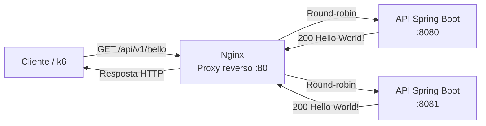

# Hello Word

[](https://openjdk.org/)
[](https://spring.io/projects/spring-boot)
[](https://maven.apache.org/wrapper/)

API HTTP simples em Spring Boot, usada para responder a uma requisição de
saudação e exercitar o encaminhamento e o balanceamento de tráfego com Nginx.

## O que a aplicação faz

A aplicação expõe um endpoint:

| Método | Caminho | Resposta |
| --- | --- | --- |
| `GET` | `/api/v1/hello` | `200 OK` com o texto `Hello World!` |

Cada requisição é registrada no log da aplicação com a porta configurada e o
endereço remoto visto pela aplicação. A porta padrão é `8080`; ela pode ser
alterada para executar mais de uma instância.

## Requisitos

- Java 25
- Nginx para o exemplo de proxy reverso
- Docker e Docker Compose, caso queira executar o teste de carga incluído

## Executar localmente

Na raiz do projeto, inicie a aplicação com o Maven Wrapper:

```bash
./mvnw spring-boot:run
```

Em outro terminal, faça uma requisição diretamente à aplicação:

```bash
curl -i http://localhost:8080/api/v1/hello
```

O corpo da resposta será:

```text
Hello World!
```

Para compilar, empacotar e executar os testes:

```bash
./mvnw test
./mvnw package
```

Depois de empacotar, o JAR pode ser executado assim:

```bash
java -jar target/hello-word-0.0.2-SNAPSHOT.jar
```

## Proxy reverso com Nginx

O Nginx recebe as conexões HTTP na porta `80` e encaminha as requisições do
endpoint para a aplicação. O exemplo abaixo configura duas instâncias locais
do serviço, nas portas `8080` e `8081`; o balanceamento padrão do Nginx entre
servidores de um `upstream` é round-robin.



Crie, por exemplo, `/etc/nginx/conf.d/hello-word.conf`:

```nginx
upstream hello_word_backend {
    server 127.0.0.1:8080;
    server 127.0.0.1:8081;
}

server {
    listen 80;
    server_name localhost;

    location /api/v1/hello {
        proxy_pass http://hello_word_backend;
        proxy_http_version 1.1;

        proxy_set_header Host $host;
        proxy_set_header X-Real-IP $remote_addr;
        proxy_set_header X-Forwarded-For $proxy_add_x_forwarded_for;
        proxy_set_header X-Forwarded-Proto $scheme;
    }
}
```

Como `proxy_pass` não inclui uma URI após o nome do `upstream`, o caminho
original (`/api/v1/hello`) é encaminhado sem alteração.

Inicie a primeira instância na porta padrão e a segunda em `8081`:

```bash
./mvnw spring-boot:run
./mvnw spring-boot:run -Dspring-boot.run.arguments=--server.port=8081
```

Em instalações nas quais o comando `spring-boot:run` não repassa essa opção,
use dois processos do JAR empacotado:

```bash
java -jar target/hello-word-0.0.2-SNAPSHOT.jar --server.port=8080
java -jar target/hello-word-0.0.2-SNAPSHOT.jar --server.port=8081
```

Valide a configuração e recarregue o Nginx:

```bash
sudo nginx -t
sudo systemctl reload nginx
```

Agora a chamada passa pelo proxy:

```bash
curl -i http://localhost/api/v1/hello
```

Para um proxy de instância única, mantenha apenas um servidor no `upstream`.
Em produção, configure também o nome de domínio e TLS conforme a infraestrutura
do ambiente.

### Endereços encaminhados

O Nginx envia `X-Real-IP` e `X-Forwarded-For`, mas a implementação atual registra
`HttpServletRequest.getRemoteAddr()`. Esse valor é o endereço remoto da conexão
que chegou à aplicação — normalmente o próprio Nginx quando há proxy — e não
usa automaticamente os cabeçalhos encaminhados. Portanto, o log atual pode
mostrar o endereço do proxy em vez do IP original do cliente.

## Teste de carga

O script `scripts/carga/teste-carga.js` usa k6 para chamar
`http://localhost/api/v1/hello` pelo Nginx. O cenário sobe gradualmente até 100
usuários virtuais, mantém essa carga por 30 segundos e então reduz a carga. Cada
requisição verifica o status `200` e o corpo exato `Hello World!`. O teste falha
se algum check não passar, se 1% ou mais das requisições falharem ou se o
percentil 95 do tempo de resposta atingir 150 ms.

Com a aplicação e o Nginx em execução, rode o teste a partir do diretório do
script:

```bash
cd scripts/carga
docker compose up --abort-on-container-exit
```

Para remover containers órfãos e reiniciar os serviços com a configuração atual:

```bash
docker compose down --remove-orphans && docker compose up
```

O Compose está configurado com `network_mode: host`, para que o container k6
acesse o Nginx pelo `localhost` da máquina. Esse modo é voltado a Linux e
compartilha a rede do host. O teste não inicia a aplicação nem o Nginx; eles
precisam estar disponíveis antes de executá-lo.

Para testar outra URL, informe `TARGET_URL` ao Compose:

```bash
TARGET_URL=http://localhost:8080/api/v1/hello docker compose up --abort-on-container-exit
```

Esse exemplo acessa a aplicação diretamente, sem passar pelo Nginx.
